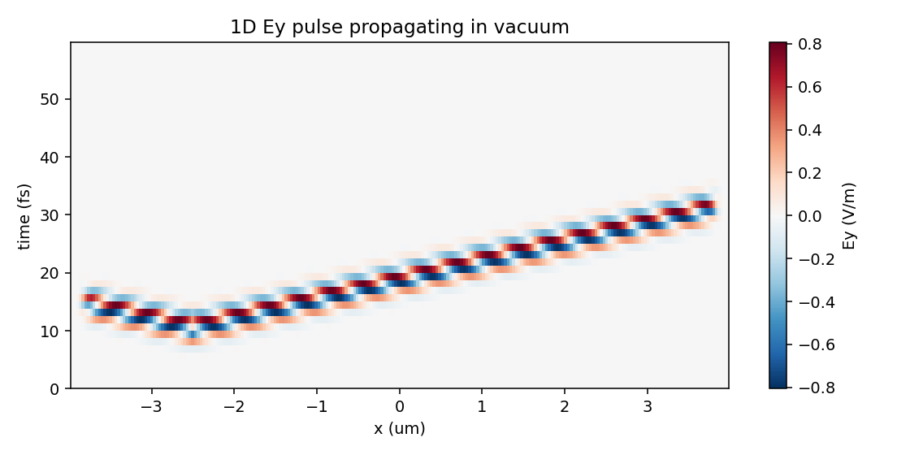
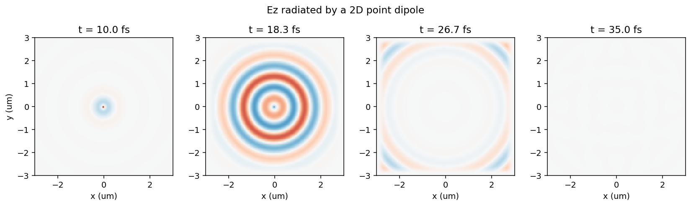
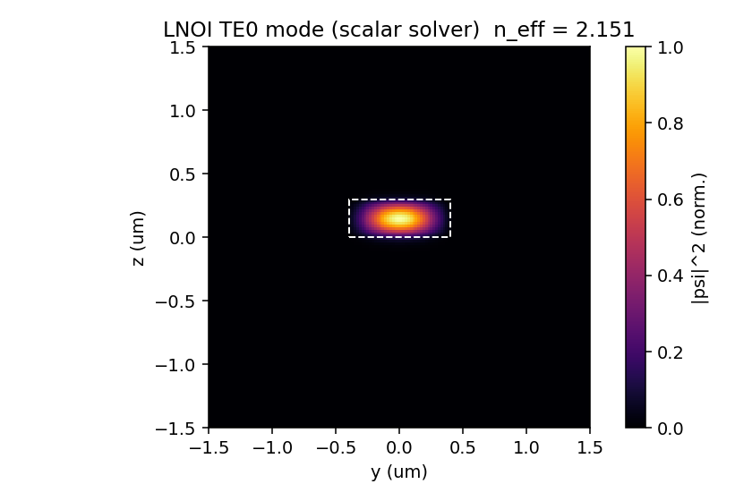
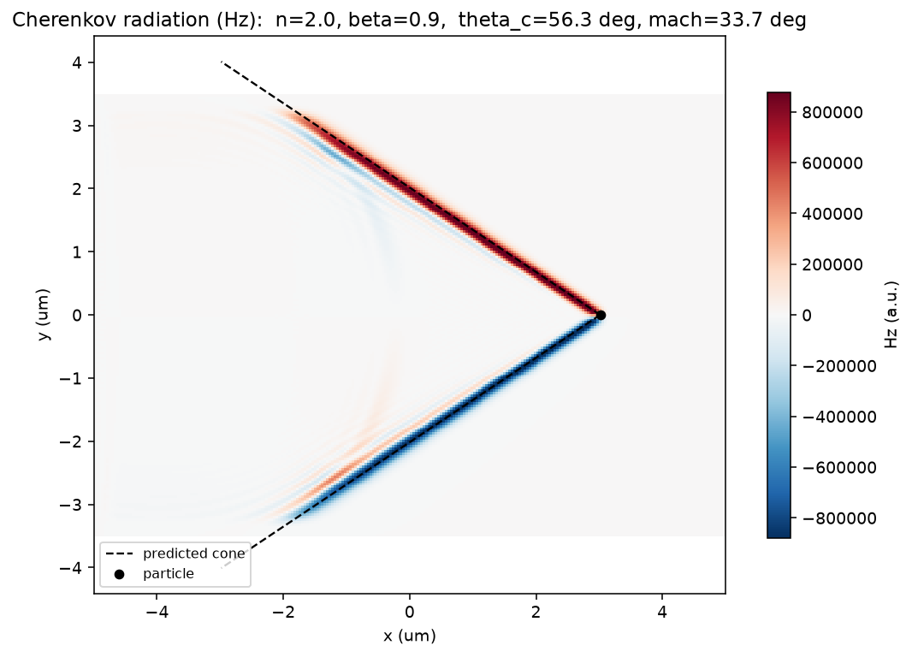
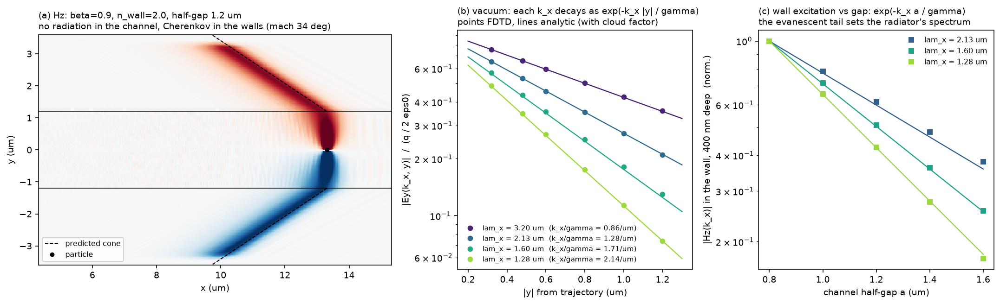

Tutorial: worked examples
=========================

The ``examples/`` directory holds five self-contained, runnable scripts. They
climb from a one-dimensional pulse up to a moving charge radiating a Cherenkov
cone, and then put that charge inside a dielectric tube; each one adds exactly
one new piece of the API or physics, so you can read them in order and never be
more than a step ahead of yourself. Every script saves the figure shown below;
run one with, e.g.::

   cd examples
   python 01_1d_vacuum_pulse.py

The figures on this page came straight out of these scripts — nothing was
touched up by hand.

1. A pulse in 1D vacuum
-----------------------

About the smallest useful simulation there is: a
:class:`~photonfdtd.GaussianPulse` driven onto a single
:class:`~photonfdtd.PointDipole`, running down a 1-D :class:`~photonfdtd.Grid`
and swallowed at both ends by the CPML. A :class:`~photonfdtd.FieldMonitor`
grabs ``Ey`` every few steps, and we draw the whole thing as a space-time
(``x`` vs ``t``) diagram — the bright diagonal streak is the pulse moving at
``c``, and it fades right where it hits the PML.

If you only read one example, read this one: it's every object you'll use in
every run — ``Grid``, ``GaussianPulse``, ``PointDipole``, ``FieldMonitor`` and
:class:`~photonfdtd.Simulation` — and nothing else.

   ``Ey`` as a function of position (horizontal) and time (vertical). The
   diagonal slope is the propagation speed; the streak vanishes at the edges
   where the CPML absorbs it.

.. literalinclude:: ../examples/01_1d_vacuum_pulse.py
   :language: python
   :linenos:

2. A point dipole radiating in 2D
---------------------------------

The same ingredients, now in two dimensions. A ``z``-polarised dipole sits at
the centre of an ``xy`` domain and throws off cylindrical waves; CPML on all
four sides quietly absorbs them. The only new trick is that the ``FieldMonitor``
records at chosen *times* instead of a fixed interval, so we can catch a few
snapshots of the wavefronts as they expand.

   Four snapshots of ``Ez`` as the cylindrical wave expands from the dipole.

.. literalinclude:: ../examples/02_2d_dipole.py
   :language: python
   :linenos:

3. Solving a waveguide mode
---------------------------

A different tool entirely: the full-vectorial :class:`~photonfdtd.ModeSolver`.
Instead of marching in time it solves an eigenvalue problem for the guided modes
of a refractive-index cross-section — here a lithium-niobate (LNOI) strip on an
oxide box. You build the cross-section the same way as everything else, with
:class:`~photonfdtd.Medium` and :class:`~photonfdtd.Box`, and the solver hands
back the effective indices and the transverse field profiles. Being
full-vectorial, it keeps TE and TM honestly apart — which matters the moment your
index contrast stops being small.

   The fundamental TE-like mode profile and its effective index.

.. literalinclude:: ../examples/03_lnoi_mode.py
   :language: python
   :linenos:

4. Cherenkov radiation from a charged particle
----------------------------------------------

Finally, a source that moves. A :class:`~photonfdtd.ChargedParticle` is fired
through a dielectric faster than the local phase velocity ``c/n``, and because it
outruns its own field it radiates a Cherenkov shock cone — the electromagnetic
cousin of a sonic boom. The fun part: the script overlays the analytic cone
half-angle (``arcsin(1/(n*beta))``) on the simulated ``Hz``, and the two land on
top of each other.

   ``Hz`` from a charge moving at ``0.9 c`` through ``n = 2``. The dashed lines
   are the predicted cone half-angle; the simulated shock front lies on them.

.. literalinclude:: ../examples/04_cherenkov.py
   :language: python
   :linenos:

5. Cherenkov radiator in a tube: an evanescent field doing the work
-------------------------------------------------------------------

Put the same charge inside a tube instead: a vacuum channel of half-gap ``a``
between two ``n = 2`` walls (the 2-D cut of a dielectric capillary radiator or
wakefield structure). In the channel ``n beta = 0.9 < 1`` and nothing radiates.
What the particle carries there is a near field whose every spatial-frequency
component ``k_x`` along the trajectory (temporal frequency ``omega = k_x v``)
is **evanescent** across the channel, falling as ``exp(-k_x |y| / gamma)``. It
is the tail of that field that reaches the wall, where ``n beta = 1.8`` and
the wall radiates a Cherenkov cone. So the wall excitation at each frequency
goes as ``exp(-k_x a / gamma)``, and the gap cuts the radiator's spectrum off
above ``omega ~ gamma v / a``: the whole device is driven by an evanescent
field, and a solver that gets that field slightly wrong gets the radiator
wrong.

The script therefore checks the field itself before showing the device. Panel
(b) is the particle in vacuum: the Fourier amplitude ``|Ey(k_x, y)|`` of its
field against distance from the trajectory, one line per ``k_x``, against the
analytic law of a moving 2-D line charge (including the Gaussian deposition
cloud's ``exp(-k_x^2 sigma^2 / 2)``). The FDTD points sit on the analytic
lines to a few percent in amplitude and within 2% in decay rate over a factor
of ten in field. Panel (c) then scans the half-gap and plots the wall field's
Fourier amplitude at fixed ``k_x`` and fixed depth inside the wall: it follows
``exp(-k_x a / gamma)`` to about 10% over the scan. What is left over is the
reflected evanescent field bouncing between the two walls, a correction of
order ``exp(-2 k_x a / gamma)``, plus a broadband floor from the discrete
source that shows at the shortest wavelengths and largest gaps.

The one trick in the script is bookkeeping, not physics. A charge that appears
at ``t = 0`` launches a light shell travelling at ``c`` while the charge moves
at ``0.9 c``, so the snapshot is taken only once the shell has pulled a full
analysis window ahead of the particle, and the Fourier transform is done over
that window around it. (The abruptly started current also leaves a static
charge behind at the start point; its smooth field only touches the lowest
``k_x`` bin.) ``tests/test_physics.py`` runs a smaller version of panel (b) as
a regression test.

   (a) ``Hz`` with the charge at ``0.9 c`` in a 2.4 um channel between ``n = 2``
   walls: the channel is quiet, the walls carry Cherenkov cones at the
   predicted angle. (b) The field of the same charge in vacuum: each spatial
   frequency decays across the channel as ``exp(-k_x |y| / gamma)`` (points
   FDTD, lines analytic). (c) Wall excitation at fixed ``k_x`` against the
   half-gap, following ``exp(-k_x a / gamma)``.

.. literalinclude:: ../examples/05_cherenkov_tube.py
   :language: python
   :linenos:
