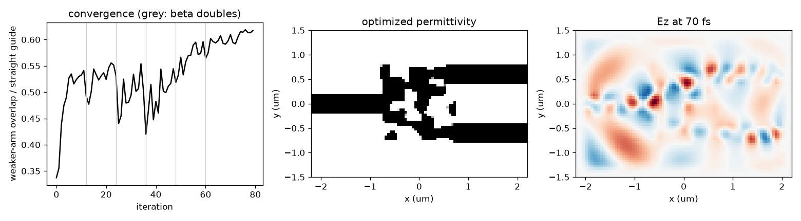
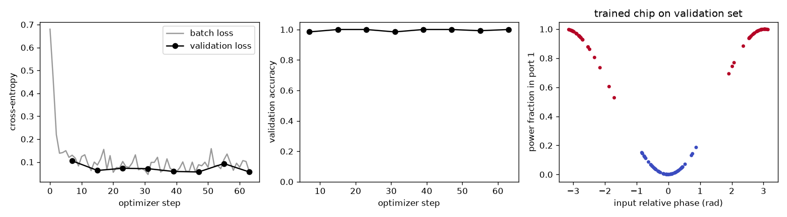
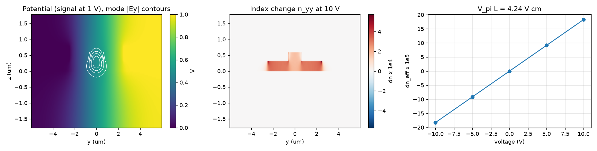
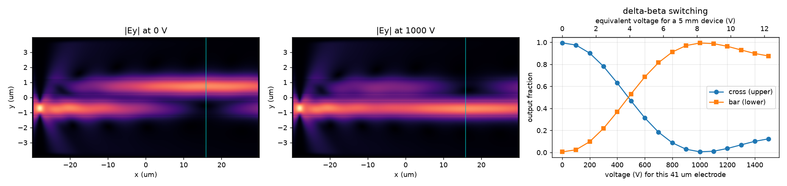
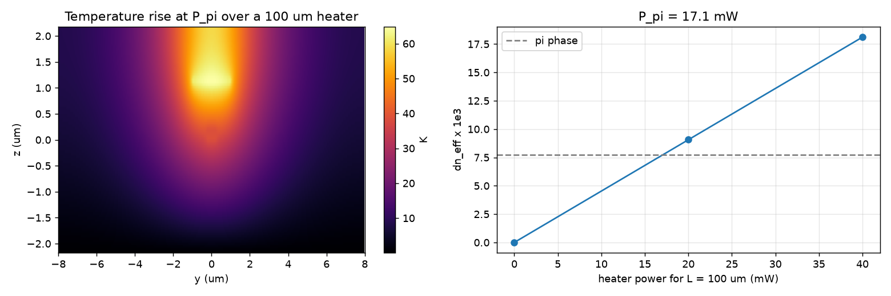
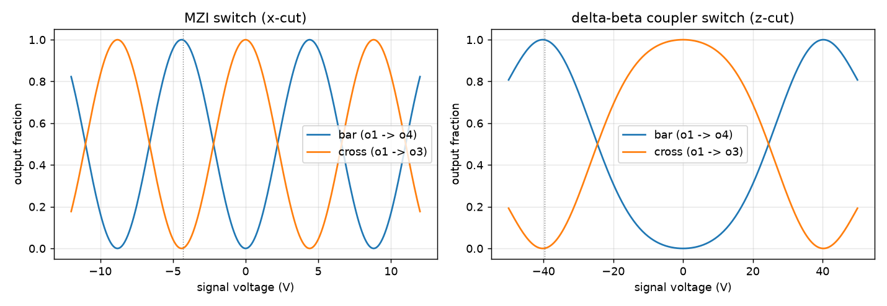

Tutorial: worked examples
=========================

The ``examples/`` directory holds eleven self-contained, runnable scripts. The
first five climb from a one-dimensional pulse up to a moving charge radiating a
Cherenkov cone, and then put that charge inside a dielectric tube; the next two
turn to design, optimizing a splitter by gradient descent and training a chip
on a dataset like a neural network; the next three switch light with voltages
and heaters, and the last draws lithium niobate switches as gdsfactory
cells. Each one adds exactly
one new piece of the API or physics, so you can read them in order and never be
more than a step ahead of yourself. Every script saves the figure shown below;
run one with, e.g.::

   cd examples
   python 01_1d_vacuum_pulse.py

The figures on this page came straight out of these scripts — nothing was
touched up by hand.

1. A pulse in 1D vacuum
-----------------------

About the smallest useful simulation there is: a
:class:`~photonfdtd.GaussianPulse` driven onto a single
:class:`~photonfdtd.PointDipole`, running down a 1-D :class:`~photonfdtd.Grid`
and swallowed at both ends by the CPML. A :class:`~photonfdtd.FieldMonitor`
grabs ``Ey`` every few steps, and we draw the whole thing as a space-time
(``x`` vs ``t``) diagram — the bright diagonal streak is the pulse moving at
``c``, and it fades right where it hits the PML.

If you only read one example, read this one: it's every object you'll use in
every run — ``Grid``, ``GaussianPulse``, ``PointDipole``, ``FieldMonitor`` and
:class:`~photonfdtd.Simulation` — and nothing else.

.. figure:: ../examples/01_1d_vacuum_pulse.png
   :width: 90%
   :alt: 1D Ey pulse propagating in vacuum

   ``Ey`` as a function of position (horizontal) and time (vertical). The
   diagonal slope is the propagation speed; the streak vanishes at the edges
   where the CPML absorbs it.

.. literalinclude:: ../examples/01_1d_vacuum_pulse.py
   :language: python
   :linenos:

2. A point dipole radiating in 2D
---------------------------------

The same ingredients, now in two dimensions. A ``z``-polarised dipole sits at
the centre of an ``xy`` domain and throws off cylindrical waves; CPML on all
four sides quietly absorbs them. The only new trick is that the ``FieldMonitor``
records at chosen *times* instead of a fixed interval, so we can catch a few
snapshots of the wavefronts as they expand.

.. figure:: ../examples/02_2d_dipole.png
   :width: 100%
   :alt: Ez radiated by a 2D point dipole at four times

   Four snapshots of ``Ez`` as the cylindrical wave expands from the dipole.

.. literalinclude:: ../examples/02_2d_dipole.py
   :language: python
   :linenos:

3. Solving a waveguide mode
---------------------------

A different tool entirely: the full-vectorial :class:`~photonfdtd.ModeSolver`.
Instead of marching in time it solves an eigenvalue problem for the guided modes
of a refractive-index cross-section — here a lithium-niobate (LNOI) strip on an
oxide box. You build the cross-section the same way as everything else, with
:class:`~photonfdtd.Medium` and :class:`~photonfdtd.Box`, and the solver hands
back the effective indices and the transverse field profiles. Being
full-vectorial, it keeps TE and TM honestly apart — which matters the moment your
index contrast stops being small.

.. figure:: ../examples/03_lnoi_mode.png
   :width: 80%
   :alt: Fundamental TE-like mode of an LNOI strip waveguide

   The fundamental TE-like mode profile and its effective index.

.. literalinclude:: ../examples/03_lnoi_mode.py
   :language: python
   :linenos:

4. Cherenkov radiation from a charged particle
----------------------------------------------

Finally, a source that moves. A :class:`~photonfdtd.ChargedParticle` is fired
through a dielectric faster than the local phase velocity ``c/n``, and because it
outruns its own field it radiates a Cherenkov shock cone — the electromagnetic
cousin of a sonic boom. The fun part: the script overlays the analytic cone
half-angle (``arcsin(1/(n*beta))``) on the simulated ``Hz``, and the two land on
top of each other.

.. figure:: ../examples/04_cherenkov.png
   :width: 100%
   :alt: Cherenkov shock cone radiated by a fast charge

   ``Hz`` from a charge moving at ``0.9 c`` through ``n = 2``. The dashed lines
   are the predicted cone half-angle; the simulated shock front lies on them.

.. literalinclude:: ../examples/04_cherenkov.py
   :language: python
   :linenos:

5. Cherenkov radiator in a tube: an evanescent field doing the work
-------------------------------------------------------------------

Put the same charge inside a tube instead: a vacuum channel of half-gap ``a``
between two ``n = 2`` walls (the 2-D cut of a dielectric capillary radiator or
wakefield structure). In the channel ``n beta = 0.9 < 1`` and nothing radiates.
What the particle carries there is a near field whose every spatial-frequency
component ``k_x`` along the trajectory (temporal frequency ``omega = k_x v``)
is **evanescent** across the channel, falling as ``exp(-k_x |y| / gamma)``. It
is the tail of that field that reaches the wall, where ``n beta = 1.8`` and
the wall radiates a Cherenkov cone. So the wall excitation at each frequency
goes as ``exp(-k_x a / gamma)``, and the gap cuts the radiator's spectrum off
above ``omega ~ gamma v / a``: the whole device is driven by an evanescent
field, and a solver that gets that field slightly wrong gets the radiator
wrong.

The script therefore checks the field itself before showing the device. Panel
(b) is the particle in vacuum: the Fourier amplitude ``|Ey(k_x, y)|`` of its
field against distance from the trajectory, one line per ``k_x``, against the
analytic law of a moving 2-D line charge (including the Gaussian deposition
cloud's ``exp(-k_x^2 sigma^2 / 2)``). The FDTD points sit on the analytic
lines to a few percent in amplitude and within 2% in decay rate over a factor
of ten in field. Panel (c) then scans the half-gap and plots the wall field's
Fourier amplitude at fixed ``k_x`` and fixed depth inside the wall: it follows
``exp(-k_x a / gamma)`` to about 10% over the scan. What is left over is the
reflected evanescent field bouncing between the two walls, a correction of
order ``exp(-2 k_x a / gamma)``, plus a broadband floor from the discrete
source that shows at the shortest wavelengths and largest gaps.

The one trick in the script is bookkeeping, not physics. A charge that appears
at ``t = 0`` launches a light shell travelling at ``c`` while the charge moves
at ``0.9 c``, so the snapshot is taken only once the shell has pulled a full
analysis window ahead of the particle, and the Fourier transform is done over
that window around it. (The abruptly started current also leaves a static
charge behind at the start point; its smooth field only touches the lowest
``k_x`` bin.) ``tests/test_physics.py`` runs a smaller version of panel (b) as
a regression test.

.. figure:: ../examples/05_cherenkov_tube.png
   :width: 100%
   :alt: A charge in a dielectric tube, the evanescent decay law of its field, and the wall excitation versus gap

   (a) ``Hz`` with the charge at ``0.9 c`` in a 2.4 um channel between ``n = 2``
   walls: the channel is quiet, the walls carry Cherenkov cones at the
   predicted angle. (b) The field of the same charge in vacuum: each spatial
   frequency decays across the channel as ``exp(-k_x |y| / gamma)`` (points
   FDTD, lines analytic). (c) Wall excitation at fixed ``k_x`` against the
   half-gap, following ``exp(-k_x a / gamma)``.

.. literalinclude:: ../examples/05_cherenkov_tube.py
   :language: python
   :linenos:

6. Inverse-designing a 1x2 splitter
-----------------------------------

The first design example. One input waveguide on the left, two outputs on the
right, and a :class:`~photonfdtd.DesignRegion` in between whose etch pattern is
free. The figure of merit is the weaker of the two output-port overlaps,
normalized by what a straight waveguide delivers, so the optimizer only
improves if it splits evenly. :func:`~photonfdtd.make_value_and_grad_params`
compiles the forward and adjoint run once, and :func:`~photonfdtd.minimize`
steps the density with Adam while
:func:`~photonfdtd.beta_continuation` doubles the projection sharpness every
10 iterations. The jumps in the convergence curve at those points are the
design being pushed toward binary. At the end the design is written to GDS if
``gdstk`` is installed. In 2-D the port readout is a Gaussian projection, a
cheap stand-in for modal power. A 3-D device would use
:class:`~photonfdtd.ModeTransmission`. See :doc:`optimization` for the whole
toolkit.

   Left: the weaker arm's overlap over 40 iterations. Middle: the optimized
   permittivity between the fixed waveguide stubs. Right: ``Ez`` as the pulse
   passes through the splitter.

.. literalinclude:: ../examples/06_inverse_design_splitter.py
   :language: python
   :linenos:

7. Training a chip like a neural network
----------------------------------------

Here the chip learns from data instead of from a hand-written figure of merit.
Two input waveguides carry coherent light, and a sample is the pair of complex
amplitudes driving them; its class is their relative phase (in phase or
anti-phase, with noise and random brightness). Detectors read the two output
powers, and the fraction of power in port ``m`` is the score for class ``m``.
:func:`~photonfdtd.train` fits the etch to 256 samples by minibatch Adam on a
cross-entropy loss.

Because the chip is linear, :class:`~photonfdtd.PhotonicModel` simulates each
input port once to get the 2x2 transfer matrix and evaluates every sample as a
matrix product. One step therefore costs two forward and two adjoint FDTD
runs, whatever the batch size. The untrained chip scores 52% on the validation
set (chance) and the trained one 100%. The right panel shows what it learned:
the power in port 1 follows ``sin^2(dphi / 2)`` of the input phase difference,
which is an interferometer.

   Left: batch and validation cross-entropy over the optimizer steps. Middle:
   validation accuracy at the end of each epoch. Right: the trained chip's
   port-1 power fraction against the input relative phase, coloured by class.

.. literalinclude:: ../examples/07_train_photonic_classifier.py
   :language: python
   :linenos:

8. A lithium niobate phase modulator
------------------------------------

The first active device (:doc:`active_devices`). An x-cut thin-film lithium
niobate rib sits between two gold electrodes 5 um apart. The optic axis runs
across the waveguide, so the TE mode and the electrodes' lateral field both use
the large r33 coefficient. :class:`~photonfdtd.ActiveRegion` solves the
potential on the mode solver's cross-section (one solve per electrode), turns
the field into the Pockels index change, and re-solves the mode at each
voltage. The script prints ``V_pi * L`` of 4.2 V cm for one arm; a push-pull
Mach-Zehnder halves it, matching the ~2.2 V cm reported for such devices.

   Left: the potential with the signal electrode at 1 V, and the mode's
   ``|Ey|``. Middle: the index change of the ``yy`` component at 10 V. Right:
   ``n_eff`` against voltage, linear as the Pockels effect is.

.. literalinclude:: ../examples/08_ln_phase_modulator.py
   :language: python
   :linenos:

9. Switching light with a voltage
---------------------------------

A delta-beta coupler switch in FDTD. Two lithium niobate waveguides couple
over their length, so light launched in the lower one crosses to the upper.
Push-pull electrodes raise one waveguide's index and lower the other's; the
detuning breaks the phase matching, and the light comes back out of the
waveguide it entered. The cross-section of example 8 gives ``d n_eff / dV``,
:meth:`~photonfdtd.active.PreparedActive.eim` carries it to a 2-D chip-plane
model with opposite signs on the two arms, and
:meth:`~photonfdtd.active.EIMActive.sweep` runs 16 voltages from one compiled
simulation. The output switches from 99.5% cross at 0 V to 99.4% bar.

The FDTD coupler is 41 um long, so it switches at about 1 kV: the voltage
scales as 1 / length, and the top axis converts to a 5 mm device (about 8 V).

   Left and middle: ``|Ey|`` at 0 V (the light crosses over) and 1000 V (it
   stays). The cyan line marks the read-out plane. Right: the cross and bar
   fractions against voltage.

.. literalinclude:: ../examples/09_eo_coupler_switch.py
   :language: python
   :linenos:

10. A heater phase shifter
--------------------------

A TiN heater 1 um above a silicon strip. The steady-state temperature is solved
on the cross-section with the substrate as the heat sink, silicon's large
thermo-optic coefficient turns it into an index change, and the mode solver
finds the power for a pi phase shift: about 17 mW, independent of the heater's
length (a longer heater spreads the same power thinner).

   Left: the temperature rise at ``P_pi`` for a 100 um heater. Right: the
   change of ``n_eff`` against heater power, with the pi-phase level dashed.

.. literalinclude:: ../examples/10_thermo_optic_heater.py
   :language: python
   :linenos:

11. Lithium niobate switch cells for gdsfactory
-----------------------------------------------

:mod:`photonfdtd.lnoi` draws thin-film LN switches as gdsfactory cells and
models each one from its own cross-section: the electrostatics and mode
solves give each waveguide's ``d n_eff / dV`` and the coupling between them,
and coupled-mode theory carries that along the millimetre-long device. The
x-cut Mach-Zehnder switch goes from cross to bar at about 4.4 V; the z-cut
delta-beta coupler, with electrodes on top of the waveguides, at about 40 V.
Needs gdsfactory (``pip install photonfdtd[gdsfactory]``).

   Bar and cross fractions from input ``o1`` against the signal voltage; the
   dotted line marks the switching voltage.

.. literalinclude:: ../examples/11_lnoi_switch_cells.py
   :language: python
   :linenos:
