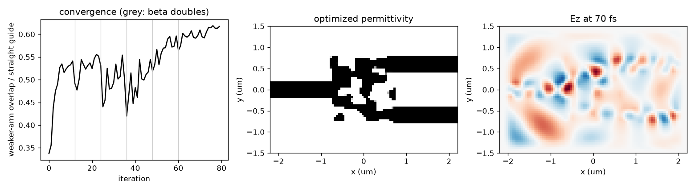

Tutorial: inverse-designing a device
====================================

This page goes through example 6 (``examples/06_inverse_design_splitter.py``)
from start to finish: a 1x2 power splitter whose shape is found by gradient
descent instead of drawn. The numbers quoted are from a run of the script as
shipped (about 10 s on a CPU). :doc:`optimization` is the reference for every
function used here; this page shows the order to use them in, and what to
check before trusting the result.

   Left: the figure of merit over the 80 iterations, with the projection
   sharpness doubling at the grey lines. Middle: the optimized etch between
   the fixed waveguide stubs. Right: ``Ez`` as the pulse passes through.

The workflow
------------

Every inverse design in photonfdtd follows the same seven steps:

1. **Build the fixed layout**: the waveguides, source and monitors that will
   not change.
2. **Run a reference** that tells you what "all the light" reads on your
   monitors.
3. **Write the figure of merit** as a function of the monitor outputs, scaled
   by the reference so it is of order one.
4. **Mark the design region** and set its minimum feature size.
5. **Optimize**, sharpening the projection as you go.
6. **Check the binary design**, since that is what gets made.
7. **Make it robust and export it.**

Step 1: the fixed layout
------------------------

.. literalinclude:: ../examples/06_inverse_design_splitter.py
   :language: python
   :lines: 25-47

``chip()`` builds one input waveguide, two output waveguides and a 1.6 µm gap
between them. A point source drives the input, and a
:class:`~photonfdtd.DFTMonitor` across the output side records the field at
1.55 µm. Nothing here is special to optimization: it is an ordinary
:class:`~photonfdtd.Simulation`, and you can ``run()`` it and look at the
fields before going further. Do that. A source in the wrong place or a monitor
inside the PML is much easier to find now than through a figure of merit that
refuses to improve.

Step 2: a reference run
-----------------------

.. literalinclude:: ../examples/06_inverse_design_splitter.py
   :language: python
   :lines: 50-56

Raw FDTD outputs are in field units, and a monitor reading of ``1e-30`` means
nothing by itself. ``chip(straight=True)`` replaces the device with a straight
waveguide, and ``p_ref`` is what one output port reads when all the light
arrives. Every later number is a fraction of that.

This also matters to the optimizer. :class:`~photonfdtd.Adam` divides by the
gradient's running magnitude plus a small ``eps``; with a loss of order
``1e-30`` the ``eps`` dominates and the design does not move.

Step 3: the figure of merit
---------------------------

.. literalinclude:: ../examples/06_inverse_design_splitter.py
   :language: python
   :lines: 58-60

Each port is read with a :class:`~photonfdtd.FieldProjection`: the monitor's
field projected onto a Gaussian at the port's position. In 2-D this is a cheap
stand-in for modal power. It is an overlap, not a power fraction, so an ideal
splitter does not read exactly 0.5. A 3-D device would use
:class:`~photonfdtd.ModeTransmission`, which projects onto the solved
waveguide mode and gives ``|S|**2`` directly.

:func:`~photonfdtd.combine` with ``reduce="min"`` returns the *weaker* port.
Maximizing a sum would be satisfied by sending everything to one arm; the
minimum only improves when both arms do. The loss is the negative of it,
because :func:`~photonfdtd.minimize` minimizes.

Step 4: the design region
-------------------------

.. literalinclude:: ../examples/06_inverse_design_splitter.py
   :language: python
   :lines: 62-66

The :class:`~photonfdtd.DesignRegion` is the box between the stubs. Its
parameters are one density per cell, ``rho`` between 0 (etched) and 1 (core).
Before it reaches the simulation, the density is

* **filtered** with a cone of radius ``filter_radius``, so no feature is much
  smaller than 120 nm here. Set this from your process's minimum feature
  size;
* **projected** through a ``tanh`` of sharpness ``beta``, which pushes it
  toward 0 or 1.

:func:`~photonfdtd.make_value_and_grad_params` then compiles one function,
``vg(rho, beta=...)``, that returns the loss and its gradient with respect to
every cell from one forward and one adjoint run. The starting point is uniform
grey, ``rho = 0.5``, which reads **0.34** here: light leaks across the gap into
both arms.

Step 5: optimize
----------------

.. literalinclude:: ../examples/06_inverse_design_splitter.py
   :language: python
   :lines: 67-73

:func:`~photonfdtd.minimize` takes an Adam step, clips the density to
``[0, 1]`` and repeats. :func:`~photonfdtd.beta_continuation` doubles ``beta``
every 12 iterations: 2, 4, 8, 16, 32, 64. Early on the projection is soft, so
material can appear and move anywhere. Later it is nearly a step, and the
design is forced to commit to core or etch.

The convergence curve shows this. The figure of merit climbs to about 0.54 in
the first stage, drops each time ``beta`` doubles (the projected design
changes under the optimizer), and recovers within a few steps. It ends at
**0.62** with a :func:`~photonfdtd.binarization` of 0.99.

Step 6: check the binary design
-------------------------------

.. literalinclude:: ../examples/06_inverse_design_splitter.py
   :language: python
   :lines: 75-78

The optimizer saw a density with some grey in it. The mask has none:
:func:`~photonfdtd.export_gds` contours the density at 0.5. Evaluating the same
parameters with a very sharp projection gives exactly that pattern, so
``vg(res.x, beta=1e3)`` is the number to quote. Here it is **0.619**, the same
as the optimized value, because the continuation ran until the design was
binary.

Stopping early does not get you there. The same script with 40 iterations,
``every=10`` and ``beta_max=16`` reports 0.54 with a binarization of 0.71, and that design reads
**0.42** as a binary etch: a fifth of the performance was in grey material that
cannot be made. If the binary number is much below the optimized one, run the
continuation further.

Step 7: robustness and export
-----------------------------

A real etch comes out slightly wider or narrower than drawn.
:func:`~photonfdtd.robust` models that by shifting the projection threshold
``eta``, and optimizes the worst of the three variants:

.. code-block:: python

   vg_robust = pf.robust(vg, etas=(0.45, 0.5, 0.55), reduce="max")
   res_r = pf.minimize(vg_robust, rho0, pf.Adam(0.05), n_iter=80,
                       schedule=pf.beta_continuation(2.0, 2.0, every=12, beta_max=64.0))

Each iteration now costs three simulations (23 s in all instead of 9 s). The
binary figure of merit of both designs, across etch thresholds:

.. list-table::
   :header-rows: 1
   :widths: 28 12 12 12 12 12

   * - ``eta``
     - 0.40
     - 0.45
     - 0.50
     - 0.55
     - 0.60
   * - nominal design
     - 0.33
     - 0.50
     - **0.62**
     - 0.50
     - 0.27
   * - robust design
     - 0.54
     - 0.55
     - 0.55
     - 0.53
     - 0.48

The nominal design is better only if it is etched exactly as drawn, and loses
half its performance at ``eta = 0.4``. The robust design gives up a little at
the nominal threshold and holds 0.48 or better across the whole range,
including the two thresholds it was not trained on.

Finally, write the design out. ``rho_phys`` is the filtered and projected
density the simulation saw, and :func:`~photonfdtd.export_gds` (needs
``gdstk``) contours it:

.. literalinclude:: ../examples/06_inverse_design_splitter.py
   :language: python
   :lines: 80-84

Adapting it to your own device
------------------------------

* **3-D devices.** Give :class:`~photonfdtd.DesignRegion` the core layer's
  ``core_z`` range and use :class:`~photonfdtd.ModeTransmission` for the
  ports. The loop is unchanged.
* **Several wavelengths.** Give the monitor several ``freqs``. The port
  objectives then return one value per frequency, and the loss can take
  their minimum for a flat response.
* **Known shapes.** If the device is a taper or a coupler with a few
  dimensions to tune, optimize those with :class:`~photonfdtd.ShapeDesign`
  instead of a density (see :doc:`optimization`).
* **Other sources.** Any source works, including a
  :class:`~photonfdtd.ChargedParticle`; a moving charge cannot use the
  reversible adjoints, so keep the default ``"checkpoint"`` or use
  ``"tiled"``.
* **Long runs.** Pass ``checkpoint="run.npz"`` to
  :func:`~photonfdtd.minimize`. An interrupted run resumes from the file and
  gives the same result as an uninterrupted one.
* **Memory.** If the grid does not fit on the device, pass ``method="tiled"``
  or one of the reversible adjoints to
  :func:`~photonfdtd.make_value_and_grad_params` (see
  :ref:`choosing-an-adjoint`).
* **A dataset instead of a figure of merit.** To train a chip on input/output
  samples, see :doc:`training_tutorial`.

If it does not converge
-----------------------

* **The loss never moves.** It is probably not of order one. Divide by a
  reference run (step 2).
* **It splits unevenly, or uses one port.** Use ``reduce="min"`` over the
  ports rather than a sum.
* **The binary number is much worse than the optimized one.** Continue to a
  higher ``beta_max``, with enough iterations at each stage to recover.
* **It collapses when beta doubles and does not recover.** Give each stage
  more iterations (``every``), or lower the learning rate.
* **Features are too small to make.** Raise ``filter_radius``, and use
  :func:`~photonfdtd.robust`.
