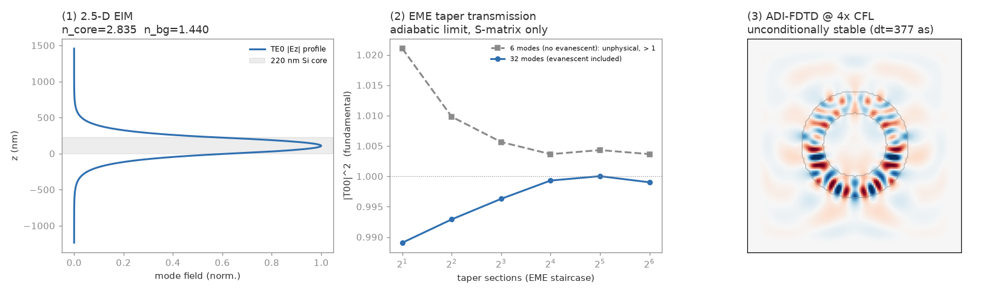

Layout-scale methods: EIM, EME, ADI-FDTD
=========================================

Brute-force 3-D FDTD of a whole photonic circuit is enormous, and most of that
cost is spent resolving things that don't need resolving: a vertical mode
profile that's the same everywhere, a straight waveguide that's uniform for a
millimetre, a CFL time step dictated by the one narrow gap on the chip. These
three methods each remove one of those costs. They compose — the effective-index
reduction hands a 2-D problem to either of the other two, or to the ordinary
FDTD solver — and, like everything else in the library, each one is checked against
an analytic result in the test suite rather than asserted.

   The three methods on one SOI platform (``benchmarks/demo_eim_eme_adi.py``):
   the 220 nm slab mode and effective indices from the EIM; a width taper's
   fundamental transmission from EME as the staircase is refined, with a
   six-mode basis (all propagating, so the junction fields cannot be matched
   and the curve overshoots unity by up to 2%) against a 32-mode basis whose
   evanescent modes bring it back to unity and below; and a dielectric ring
   stepped by ADI-FDTD at four times the explicit CFL limit.

2.5-D effective-index method
----------------------------

A PIC layer is a thin core (Si, SiN, LiNbO3) etched into an in-plane pattern on a
substrate under a cladding. The effective-index method (EIM) collapses the
vertical dimension: solve the 1-D slab mode of the layer stack where the core is
present to get ``n_core``, solve it again where the core has been etched away to
get ``n_background``, and then simulate the device as a 2-D problem in the chip
plane with those two indices. That's two to three orders of magnitude fewer
cells and timesteps, and the resulting 2-D :class:`~photonfdtd.Simulation` is an
ordinary one, so it runs and differentiates like any other.

.. code-block:: python

   lam = 1.55e-6
   eim = pf.EffectiveIndex2D.from_stacks(
       core_layers=[pf.Layer(0.22e-6, 3.48)],     # 220 nm Si where the core is
       etched_layers=[pf.Layer(0.22e-6, 1.44)],   # oxide where it's etched away
       wavelength=lam, polarization="TE",
       substrate_index=1.44, cladding_index=1.0)
   print(eim.n_core, eim.n_background)          # ~2.83 (TE0 of 220 nm SOI) and 1.44 (the etched oxide guides nothing)

   core, background = eim.effective_index_media()
   wg = pf.Box(center=(0, 0), size=(20e-6, 0.5e-6), medium=core)
   grid = pf.Grid(size=(24e-6, 6e-6), cell_size=25e-9, pml_layers=(12, 12, 0))
   sim = pf.Simulation(grid, structures=[wg], ...)

The 1-D slab solver underneath (:func:`~photonfdtd.slab_modes`) is a
finite-difference eigenproblem: TE obeys the plain Helmholtz form and TM the
``eps d/dz (1/eps dH/dz)`` form, so the discontinuous-permittivity interface
conditions are built in rather than smeared. Cells straddling a layer boundary
get a length-weighted subpixel average (arithmetic for TE, harmonic for TM). It
reproduces the analytic symmetric-slab dispersion to ~1e-3 at the default
resolution and converges at second order when you refine ``dz``
(``tests/test_eim_eme_adi.py``). :class:`~photonfdtd.Layer` thicknesses are in
metres and the index can be a float, a :class:`~photonfdtd.Medium`, or a
:class:`~photonfdtd.DispersiveMedium` evaluated at the solve wavelength. If the
etched region doesn't guide at all (common for a full etch to oxide), the
background falls back to the highest surrounding index, which is the right
contrast for the in-plane problem.

The honest caveat: the EIM assumes the vertical profile is separable from the
in-plane confinement. That's excellent for routing — waveguides, bends,
directional couplers, MZIs — and degrades for strongly 3-D features like deep
sub-wavelength gaps or out-of-plane grating diffraction. It's exact in the slab
limit and it's the standard way to get a layout-scale answer in minutes instead
of days.

Eigenmode expansion
-------------------

FDTD time-steps every cell for thousands of steps. For a device built from
sections that are *uniform along the propagation axis* — straight guides, step
junctions, and (as a staircase of short slices) tapers and adiabatic
transitions — eigenmode expansion (EME) is astronomically cheaper. Each section
is represented by the handful of local eigenmodes it supports; within a section
a mode just picks up a phase ``exp(i beta L)``; and the device S-matrix is the
cascade of one small mode-overlap scattering matrix per interface with the
diagonal propagation matrices in between, combined with the Redheffer star
product. The cost is set by the number of modes you keep, not by the device
length: a millimetre-long taper costs the same as a micron-long one.

.. code-block:: python

   import numpy as np

   dy, ny = 15e-9, 260
   y = (np.arange(ny) - ny / 2) * dy            # lam = 1.55e-6 as above

   def wg(width):                               # eps_r(y) of a strip of this width
       e = np.full(ny, 1.44 ** 2)
       e[np.abs(y) <= width / 2] = 2.83 ** 2    # the EIM core index from above
       return e

   # A 6 um linear taper 0.5 -> 0.2 um as 32 uniform slices
   widths = np.linspace(0.5e-6, 0.2e-6, 32)
   sections = [pf.Section(wg(w), 6e-6 / 32) for w in widths]
   r = pf.eme_2d(sections, dy, lam, num_modes=32)
   T = abs(r.transmission(0, 0)) ** 2           # fundamental -> fundamental
   R = abs(r.reflection(0, 0)) ** 2
   assert abs(r.power_balance() - 1) < 1e-3     # the basis is converged

:func:`~photonfdtd.eme_2d` returns an :class:`~photonfdtd.EMEResult` carrying
the full ``2N x 2N`` scattering matrix, the modal effective indices of the input
and output sections, and ``transmission()`` / ``reflection()`` helpers for the
block you usually want. :func:`~photonfdtd.sections_from_eps` slices a 2-D
``eps_r(x, y)`` map — say, one you built with the EIM media and ordinary
geometry — into x-uniform sections column by column, so a taper or a bend
becomes a staircase at the resolution of the grid.

Scope is 2-D, single polarisation, propagation along x with the transverse
profile along y. That is exactly the problem the EIM leaves behind, so the two
together take a layout-scale device to an S-matrix without ever time-stepping
it. ``"Ez"`` (the default) is the out-of-plane-E polarisation of a 2-D ``xy``
grid; ``"Hz"`` is the dual. The validation is what you'd hope for: a uniform
guide is transparent (``|T| = 1``, ``|R| = 0``) to machine precision and
accumulates exactly ``exp(i beta L)`` of phase, the fundamental reflection
of a waveguide-width step reproduces the Fresnel value built from the two
effective indices, and the step conserves power to ``1e-3`` once the basis is
converged.

**How many modes.** The field mismatch at a junction is carried by the
evanescent modes, the ones below cutoff that decay away from the interface. A
basis that holds only propagating modes cannot satisfy ``Ez`` and ``Hy``
continuity at once, and the symptom is silent: transmission above unity. The
3.9 um box in the snippet supports eight propagating modes, so six modes is
not a small basis but a *wrong* one, and ``|T00|^2`` comes out at 1.02; with 32
modes it settles at 0.989 and the total scattered power at 1.000 (1.0000 by 64 modes).
``num_modes`` should be several times the number of propagating modes the
transverse box supports (wider boxes hold more, so need more).
:func:`~photonfdtd.eme_2d` warns when a section at a junction has no
evanescent mode in its basis, and :meth:`~photonfdtd.EMEResult.power_balance`
is the convergence check to run before trusting a number. The transverse
boundary is a hard wall with no absorber, so radiation that reaches the box
edge is reflected rather than lost; keep the box wide enough that the modes
you care about do not feel it.

CFL-free ADI-FDTD
-----------------

Explicit Yee FDTD is bound by the Courant–Friedrichs–Lewy limit: ``dt`` can't
exceed roughly ``dx / (c sqrt(D))``. On a circuit grid a single small feature —
a narrow gap, a thin sidewall — forces a small ``dx`` wherever it touches, and
CFL then forces a small ``dt`` over the *whole* domain for *every* step, even
where the fields are smooth. The alternating-direction-implicit scheme
(Namiki 1999; Zheng, Chen & Zhang 2000) removes the stability bound entirely:
it is **unconditionally stable**, so ``dt`` is set by accuracy alone. Where CFL
was the binding constraint, that's a 3–10x cut in the number of steps.

The price is two implicit sub-steps per full step — one direction implicit and
the other explicit, then swapped — each a set of *independent* tridiagonal
solves. Those independent lines are the natural unit of parallel work, so each
sub-step runs them as one batched ``jax.lax.linalg.tridiagonal_solve`` inside a
JIT-compiled ``lax.scan`` over the timesteps (``precision="float32"`` or
``"float64"``).

.. code-block:: python

   import math
   import numpy as np

   eps = np.ones((120, 120))
   # ... stamp a dielectric ring, eps[(r > 18) & (r < 30)] = 2.6**2 ...

   def gauss(f0, fwhm):
       sig = fwhm / (2 * math.sqrt(2 * math.log(2))); t0 = 4 * sig
       return lambda t: np.exp(-((t - t0) / sig) ** 2) * np.sin(2 * math.pi * f0 * (t - t0))

   src = pf.ADISource(60, 84, gauss(pf.C_0 / 1e-6, 8e-15))     # grid indices (i, j)
   sim = pf.ADISimulation2D(eps, 40e-9, courant_factor=4.0,     # 4x the CFL step
                            boundary="absorber", pml_cells=16,
                            sources=[src])
   res = sim.run(500, snapshot_interval=50, probes=[(60, 60)])
   Ez_frames = res.snapshots["Ez"]            # (n_frames, nx, ny)
   trace = res.probes["60,60"]                # Ez at that cell, every step

:class:`~photonfdtd.ADISimulation2D` is deliberately its own small class rather
than a mode of ``Simulation``: it works on an explicit ``eps_r(x, y)`` array for
the 2-D ``(Ez, Hx, Hy)`` polarisation (again, the one the EIM produces), with
soft ``Ez`` point sources at grid indices and two boundary options. ``"pec"`` is
a closed cavity, handy for showing that a resonance doesn't move with ``dt``;
``"absorber"`` is a graded, impedance-matched electric + magnetic conductivity
layer — a serviceable open boundary, though not as reflectionless as the
explicit solver's CPML. Pass ``dt=`` directly or ``courant_factor=`` as a
multiple of the explicit CFL step; values above 1 are the point.

What the tests pin down: the scheme stays finite and bounded at **8x** the
explicit CFL step, where an explicit Yee update is NaN by 2x; a PEC vacuum
cavity's dominant resonance lands on the analytic mode at 2x CFL (about 0.5%
off when I measured it; the test allows 2%); the absorber leaves a residual field
whose L2 norm is three orders of magnitude below a PEC wall's (six in energy);
and a float32 run tracks float64 to better than 1e-4 of the peak field.

Putting them together
---------------------

The workflow these were built for, on a silicon-on-insulator platform:

1. Reduce the layer stack with :class:`~photonfdtd.EffectiveIndex2D` and build
   the plan-view geometry from its two media.
2. For the pieces that are piecewise-uniform along their axis — access guides,
   tapers, step junctions — get S-parameters from :func:`~photonfdtd.eme_2d`
   in milliseconds.
3. For the pieces that aren't — a focusing grating, a ring, an inverse-designed
   splitter — run the 2-D FDTD (on the GPU if you have one; see
   :doc:`backends`), or on :class:`~photonfdtd.ADISimulation2D` when a fine
   feature is dragging the CFL step down.

References
----------

* S. L. Chuang, *Physics of Photonic Devices*, and K. Okamoto, *Fundamentals of
  Optical Waveguides* — the two-step effective-index method.
* D. F. G. Gallagher & T. P. Felici, "Eigenmode expansion methods for
  simulation of optical propagation in photonics," *Proc. SPIE* **4987** (2003).
* A. W. Snyder & J. D. Love, *Optical Waveguide Theory*, ch. 31 — mode
  orthogonality and the star product.
* T. Namiki, "A new FDTD algorithm based on alternating-direction implicit
  method," *IEEE Trans. Microw. Theory Tech.* **47**\ (10), 2003 (1999).
* F. Zheng, Z. Chen, J. Zhang, "Toward the development of a three-dimensional
  unconditionally stable finite-difference time-domain method," *IEEE Trans.
  Microw. Theory Tech.* **48**\ (9), 1550 (2000).
