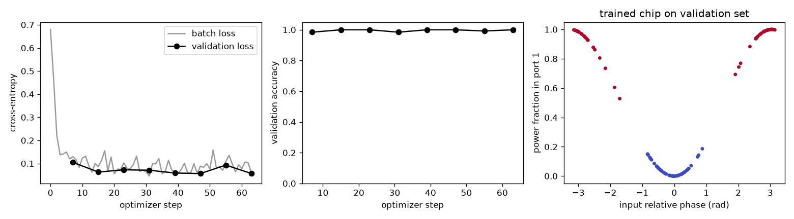

Tutorial: training a chip on inputs and outputs
================================================

This page goes through example 7 (``examples/07_train_photonic_classifier.py``)
from start to finish. A small 2-D chip is trained, the way you would train a
neural network, to classify pairs of light signals by their relative phase. The
numbers quoted are from a run of the script as shipped (about 15 s on one GPU).
:doc:`optimization` explains the machinery; this page shows it in use.

         output power fraction against input phase

   Left: minibatch and validation cross-entropy over the 64 optimizer steps.
   Middle: validation accuracy per epoch. Right: the trained chip on the
   validation set, the share of power in output port 1 against the input
   relative phase, coloured by class.

The task
--------

Two input waveguides carry coherent light at 1.55 µm. One sample is the pair of
complex amplitudes ``x = [a0, a1]`` driving them:

* **class 0**: the two inputs are in phase (relative phase about 0);
* **class 1**: they are in anti-phase (relative phase about π).

Every sample has 0.5 rad of phase jitter and a random overall brightness
between 0.5× and 1.5×. The total power therefore carries no information about
the class, and a chip can only solve the task by making the two inputs
interfere.

The chip has two output ports. The share of the detected power that reaches
port ``m`` is the score for class ``m``: the chip "says" class 1 when most of
the light leaves through port 1.

Step 1: one simulation per input port
-------------------------------------

.. literalinclude:: ../examples/07_train_photonic_classifier.py
   :language: python
   :lines: 25-46

``chip(port)`` builds the whole device with only input ``port`` driven: four
waveguide stubs (two in, two out), a point source in the chosen input, and a
:class:`~photonfdtd.DFTMonitor` across the output side that records the field
at 1.55 µm. The two simulations differ *only* in which input is driven;
:class:`~photonfdtd.PhotonicModel` checks that their grids, time steps and
structures match.

Why one per input? The chip is linear in the fields, so for a given etch it is
an exact complex transfer matrix ``T`` (here 2 × 2). Driving input ``n`` alone
measures column ``n`` of ``T``, and any sample is then ``a = T @ x``, with no
further simulation.

Step 2: readouts, the trainable box and the model
-------------------------------------------------

.. literalinclude:: ../examples/07_train_photonic_classifier.py
   :language: python
   :lines: 47-54

* **Readouts.** :class:`~photonfdtd.FieldProjection` gives one complex
  amplitude per output port: the monitor's field projected onto a Gaussian at
  that port's position. It is linear in the field, as a readout must be for
  ``T`` to be exact. On a 3-D chip with ports normal to x, use
  :class:`~photonfdtd.ModeTransmission` instead, which projects onto the
  solved waveguide mode.
* **Design region.** The :class:`~photonfdtd.DesignRegion` is the 1.6 × 2.0 µm
  box between the stubs. Its etch density ``rho`` (one value per cell, 0 =
  etched, 1 = core) is the set of weights to train. Everything outside the box
  stays exactly as built. ``filter_radius`` sets the smallest feature the
  design can contain.
* **Model.** :class:`~photonfdtd.PhotonicModel` ties these together:
  ``model.transfer(rho)`` runs the two simulations and returns ``T``, and
  ``model.predict(rho, X)`` returns the detected port powers for a batch of
  inputs.

Step 3: the data and the starting point
---------------------------------------

.. literalinclude:: ../examples/07_train_photonic_classifier.py
   :language: python
   :lines: 57-68

``X`` has shape ``(n_samples, n_inputs)`` and is complex; ``Y`` holds integer
labels. Training starts from a uniform grey density (``rho = 0.5``
everywhere), which classifies at chance: **52 %** validation accuracy.

Step 4: train
-------------

.. literalinclude:: ../examples/07_train_photonic_classifier.py
   :language: python
   :lines: 69-71

Each optimizer step, :func:`~photonfdtd.train`:

1. runs the 2 port simulations to get ``T``;
2. computes the whole minibatch of 32 samples as ``T @ x`` and squares it to
   detected powers, ``|a|**2``. That squaring is the network's only
   nonlinearity;
3. takes the cross-entropy of the per-port power shares against the labels;
4. pulls the gradient back to every cell of the box through 2 adjoint
   simulations;
5. takes an :class:`~photonfdtd.Adam` step and clips the density to [0, 1].

So a step costs 2 forward and 2 adjoint FDTD runs whatever the batch size. The
256 training samples make 8 steps per epoch, 64 in all. The schedule
:func:`~photonfdtd.beta_continuation` doubles the projection sharpness ``beta``
every 16 steps (2 → 4 → 8 → 16): early on, material can move freely, and later
the pattern is pushed towards a fabricable, binary etch.

Because ``validation=(Xv, Yv)`` is given, every epoch ends with an evaluation
on the 128 held-out samples:

.. list-table::
   :header-rows: 1
   :widths: 14 10 22 24

   * - epoch
     - ``beta``
     - validation loss
     - validation accuracy
   * - untrained
     - 2
     - —
     - 52 %
   * - 0
     - 2
     - 0.105
     - 98.4 %
   * - 1
     - 2
     - 0.063
     - 100 %
   * - 2
     - 4
     - 0.073
     - 100 %
   * - 3
     - 4
     - 0.071
     - 98.4 %
   * - 4
     - 8
     - 0.059
     - 100 %
   * - 5
     - 8
     - 0.057
     - 100 %
   * - 6
     - 16
     - 0.093
     - 99.2 %
   * - 7
     - 16
     - 0.057
     - **100 %**

The bumps (validation loss up at epochs 2 and 6, accuracy dipping at epochs 3
and 6) follow the doublings of ``beta`` at steps 16 and 48: each jump in
sharpness changes the projected design a little, and the next few steps
recover from it. The final design has a :func:`~photonfdtd.binarization` of
0.85 (1.0 is fully binary).

Step 5: what the chip learned
-----------------------------

.. literalinclude:: ../examples/07_train_photonic_classifier.py
   :language: python
   :lines: 72-73

``model.transfer(rho, beta=...)`` shows how the chip solves the task. The
normalized ``|T|**2`` before and after training:

.. list-table::
   :header-rows: 1
   :widths: 20 40 40

   * -
     - untrained (``rho = 0.5``)
     - trained
   * - ``|T|**2``
     - ``[[1, 0.25], [0.25, 1]]``
     - ``[[1, 0.95], [0.95, 0.93]]``
   * - in-phase input, power to port 1
     - 50 %
     - **0.0 %**
   * - anti-phase input, power to port 1
     - 50 %
     - **99.7 %**

Untrained, each input mostly goes straight through to the port opposite it, so
both classes put half their power into port 1 and the chip cannot tell them
apart. Trained, every input splits about equally between both outputs, and the
etch sets the relative phases so that in-phase light interferes into port 0 and
anti-phase light into port 1. Training has rediscovered a 50:50 interferometric
coupler, which is the textbook device for this task.

Step 6: use the result
----------------------

.. code-block:: python

   P = model.predict(res.x, Xv, beta=16.0)        # (n, 2) detected port powers
   pf.accuracy(P, Yv)                              # 1.0
   rho = region.rho_phys(sims[0], res.x, beta=16.0)
   pf.export_gds("classifier.gds", region=region, rho=rho, grid=sims[0].grid)

``res.x`` is the latent density the optimizer moved. ``rho_phys`` is the
filtered and projected pattern the simulation actually saw, and that is what
gets fabricated. :func:`~photonfdtd.export_gds` (needs ``gdstk``) contours it
and writes it to GDS.

Adapting it to your own problem
-------------------------------

* **More ports.** Use one simulation per input port and one readout per output.
  The cost of a step grows with the number of inputs, never with the dataset.
* **Wavelength channels.** Give the monitors several ``freqs`` and ``X`` the
  shape ``(n, n_freq, N)``. The detected power is summed over frequency.
* **Other losses.** ``loss="mse"`` fits target output powers, or pass your own
  ``loss(pred, y)``. Keep it of order one: raw FDTD powers are tiny (about
  ``1e-30`` here), so compare power *fractions* or normalize first, or Adam's
  ``eps`` swamps the gradient.
* **A fixed matrix instead of a dataset.** To make the chip implement a known
  linear map (a splitter, a DFT, a mode router), use
  :func:`~photonfdtd.fit_transfer`.
* **Robustness to fabrication.** Wrap the gradient in :func:`~photonfdtd.robust`
  to train against eroded and dilated versions of the etch too.
* **Larger grids.** Pass ``method="tiled"`` (with ``tiled_options``) to
  :class:`~photonfdtd.PhotonicModel` and :func:`~photonfdtd.train` to keep the
  port simulations on disk, or one of the reversible adjoints when there are
  no lossy materials (see :doc:`optimization`).
